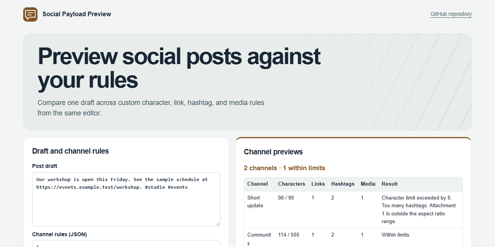

# Social Payload Preview

**Preview social posts against your rules.** Compare one draft across custom character, link, hashtag, and media rules from the same editor.

[Open the live tool](https://musabukhari237.github.io/social-payload-preview/) · [Report an issue](https://github.com/MusaBukhari237/social-payload-preview/issues)

[](https://musabukhari237.github.io/social-payload-preview/)

## Try it

Choose **Load example channels**, then **Check draft**. Use your publishing rules for each channel. Enter attachment dimensions to check their aspect ratios.

## How it works

Counts Unicode code points, links and hashtags. Rule sets can specify character, link, hashtag and attachment budgets, plus an optional fixed link weight and aspect ratio range. Sample limits are fictional.

## Run locally

Clone the repo and serve the `docs` folder from localhost.

```sh
python -m http.server 8000 --bind 127.0.0.1 --directory docs
```

Open http://127.0.0.1:8000 in a current browser. Run `node --test` from the repository root with Node.js 22 or later.

## Sponsors

Supported by [LeadCeleris](https://www.leadceleris.com/) and [AIFFICIENTO](https://www.aifficiento.biz/).

## Contributing

Read [CONTRIBUTING.md](CONTRIBUTING.md) and use synthetic fixtures in issue reports. The source is available under the [MIT license](LICENSE).
